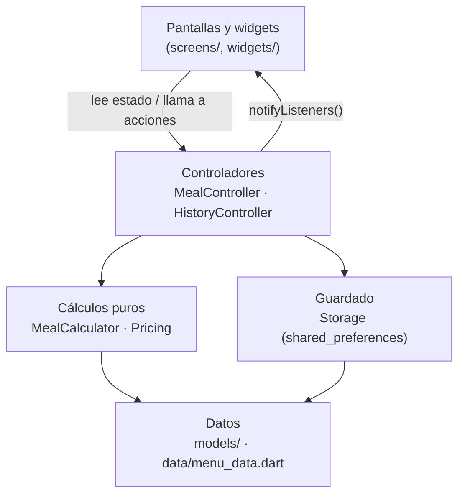
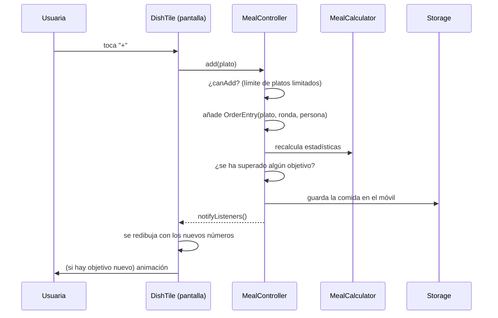
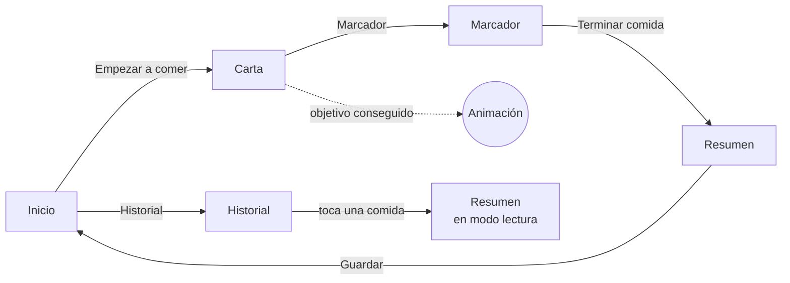

# Memoria técnica · Zake Tracker

> Documento que explica qué hace la app, cómo está construida, por qué se tomó cada decisión y cómo ampliarla. Está escrito pensando en alguien que **empieza con Flutter**, así que al final hay un glosario con los conceptos básicos.

---

## Índice

1. [Objetivo del proyecto](#1-objetivo-del-proyecto)
2. [Funcionalidades](#2-funcionalidades)
3. [Elección de la tecnología](#3-elección-de-la-tecnología)
4. [Arquitectura](#4-arquitectura)
5. [El modelo económico: ¿cuándo pierde Zake?](#5-el-modelo-económico-cuándo-pierde-zake)
6. [Reglas del buffet implementadas](#6-reglas-del-buffet-implementadas)
7. [Pantallas](#7-pantallas)
8. [Objetivos misteriosos y animaciones](#8-objetivos-misteriosos-y-animaciones)
9. [Guardado de datos](#9-guardado-de-datos)
10. [Diseño visual y accesibilidad](#10-diseño-visual-y-accesibilidad)
11. [Tests](#11-tests)
12. [Estructura de archivos](#12-estructura-de-archivos)
13. [Cómo modificar o ampliar la app](#13-cómo-modificar-o-ampliar-la-app)
14. [Limitaciones conocidas y trabajo futuro](#14-limitaciones-conocidas-y-trabajo-futuro)
15. [Glosario de Flutter para principiantes](#15-glosario-de-flutter-para-principiantes)
16. [Avisos](#16-avisos)

---

## 1. Objetivo del proyecto

Zake es un restaurante asiático de San Juan de Alicante con un **buffet libre a la carta**: se paga un precio fijo por persona y se piden platos de la carta tantas veces como se quiera (salvo algunos "limitados").

La pregunta que responde la app es sencilla: **¿lo que nos hemos comido le ha costado al restaurante más de lo que le hemos pagado?** Si es así, "le hemos ganado al buffet".

Para que sea divertido y no una simple calculadora, la app añade:

- un **marcador en directo** con objetivos ocultos que se desbloquean con animaciones,
- **modo grupo** con ranking (¿quién de la mesa le ha costado más?),
- un **historial** con rachas de victorias.

---

## 2. Funcionalidades

| Funcionalidad | Descripción | Dónde está |
|---|---|---|
| Elegir día | Entre semana o finde/festivos (cambia el precio). Se sugiere solo según el día y la hora. | `home_screen.dart`, `pricing.dart` |
| Comensales | Adultos, niños (≤ 1,30 m) y menores de 3 años, con nombre editable. | `home_screen.dart` |
| Carta completa | 94 platos de comida + 19 bebidas y postres, por categorías. | `menu_data.dart` |
| Rondas | Cada plato se apunta en una ronda; se puede crear una nueva o volver a una anterior. | `meal_controller.dart`, `meal_screen.dart` |
| Asignar a persona | Cada plato se apunta a quien lo pide (para el ranking). | `meal_screen.dart` (`_DinerBar`) |
| Platos limitados | Uno por persona en toda la comida; el botón **+** se bloquea al llegar al tope. | `MealController.canAdd` |
| Platos de finde | La categoría "Fin de semana" solo aparece si el día es de finde. | `categoriesFor`, `dishesFor` |
| Buscador | Busca por nombre, ingredientes, categoría o número, sin importar tildes ni mayúsculas. | `utils/search.dart`, `meal_screen.dart` |
| Filtros | Muy pedidos, picantes, sin picante, limitados y ya pedidos; se combinan entre sí y con el buscador. | `meal_screen.dart` (`DishFilter`) |
| Picante | Guindillas dibujadas (de 1 a 3) según la carta. | `widgets/chili_icon.dart` |
| Muy pedido | Fuego naranja en los platos favoritos del historial o pedidos 3+ veces en la comida. | `HistoryController.popularDishIds` |
| Marcador | Medidor de 0 % a 150 %, cifras clave y sugerencias para "remontar". | `score_screen.dart`, `score_gauge.dart` |
| Objetivos | 6 objetivos ocultos con animación propia. | `goal.dart`, `goal_art.dart`, `goal_dialog.dart` |
| Bebidas y postres | Suman beneficio a Zake. | `pricing.dart`, `meal_calculator.dart` |
| Resumen | Resultado, comparación, categorías, ranking y estadísticas. | `summary_screen.dart` |
| Historial | Comidas guardadas, victorias, rachas, mejor comida y plato favorito. | `history_screen.dart`, `history_controller.dart` |
| Comida a medias | Si se cierra la app en mitad de la cena, se recupera al abrirla. | `storage.dart` |

---

## 3. Elección de la tecnología

### 3.1. ¿Por qué Flutter y no SwiftUI?

La idea inicial era hacer la app para iPhone con **SwiftUI**, pero se quería que también funcionara en **Android**. SwiftUI solo funciona en dispositivos de Apple, así que habría obligado a escribir la app **dos veces** (Swift para iOS y Kotlin para Android).

Se valoraron estas opciones:

| Opción | Un solo código para iOS y Android | Se puede desarrollar en Windows | Comentario |
|---|---|---|---|
| SwiftUI + Kotlin nativo | ❌ | ❌ (Swift necesita Mac) | Doble trabajo. |
| React Native | ✅ | ✅ | Bueno, pero las animaciones dibujadas a mano son más incómodas. |
| Kotlin Multiplatform | ✅ (parcial) | ✅ | Más complejo para empezar. |
| **Flutter** | ✅ | ✅ | **Elegida.** |

**Motivos para elegir Flutter:**

1. **Un único código** para Android, iOS y web.
2. **Se programa desde Windows** y se prueba en Android o en Chrome sin necesitar un Mac.
3. **Dart**, su lenguaje, es muy parecido a Java y C#, que ya se ven en la carrera.
4. Flutter **dibuja él mismo cada píxel**, así que la app se ve igual en todos los móviles. Eso es justo lo que se necesita para un diseño muy personalizado y con ilustraciones animadas.
5. Tiene **"hot reload"**: guardas el código y el cambio aparece en el móvil en un segundo, sin perder el estado. Ideal para aprender.

### 3.2. Paquetes (dependencias) usados

Se han usado **solo tres paquetes**, todos muy populares y mantenidos, para que el proyecto sea fácil de entender:

| Paquete | Para qué | Por qué este |
|---|---|---|
| `provider` | Compartir el estado (la comida en curso, el historial) entre pantallas y redibujarlas cuando cambia. | Es el método que recomienda la documentación oficial para empezar: sencillo y sin "magia". |
| `shared_preferences` | Guardar datos en el móvil. | Para guardar dos textos JSON (comida actual e historial) es suficiente; una base de datos sería excesiva. |
| `google_fonts` | Tipografías DM Sans y Bricolage Grotesque. | Evita tener que meter los archivos de fuentes a mano. |

**Lo que *no* se ha usado, a propósito:**

- **Ni servidor ni cuentas de usuario**: todo funciona sin internet (salvo descargar las fuentes la primera vez) y los datos no salen del móvil. Más privacidad y nada que mantener.
- **Ni GIFs ni Lottie para las animaciones**: se dibujan con código (ver sección 8). Así no hay archivos pesados ni problemas de derechos de autor, y los colores encajan siempre con la app.
- **Ni fotos de la carta**: las fotos del PDF del restaurante tienen derechos; en su lugar cada plato tiene un dibujo generado por código.

---

## 4. Arquitectura

La app está separada en **capas**. Cada capa solo conoce a las de debajo:



**¿Por qué así?**

- **Las pantallas no hacen cuentas.** Solo muestran datos y llaman a métodos como `controller.add(plato)`. Si mañana se cambia el diseño, la lógica no se toca.
- **Los cálculos son funciones puras** (`MealCalculator.calculate`): reciben una comida y devuelven números, sin efectos secundarios. Por eso se pueden probar con tests sin abrir la app.
- **Un único sitio para cada cosa:** precios en `pricing.dart`, carta en `menu_data.dart`, objetivos en `goal.dart`. Cambiar algo no obliga a buscar por todo el proyecto.

### 4.1. Cómo viaja un toque en el botón "+"



### 4.2. Gestión del estado con Provider

En `main.dart` se crean los dos controladores y se "cuelgan" encima de toda la app con `MultiProvider`. Desde cualquier pantalla:

- `context.watch<MealController>()` → lee el controlador **y** se redibuja cuando cambia.
- `context.read<MealController>()` → lo lee una vez (para llamar a un método desde un botón).

`MealController` extiende `ChangeNotifier`: cada vez que algo cambia llama a `notifyListeners()` y Flutter redibuja las pantallas que lo están "mirando".

### 4.3. Caché de estadísticas

Calcular las estadísticas recorre todos los platos pedidos. Como la pantalla puede redibujarse muchas veces, `MealController.stats` guarda el resultado en `_statsCache` y solo lo recalcula cuando cambia algo (`_changed()` borra la caché).

---

## 5. El modelo económico: ¿cuándo pierde Zake?

Esta es la parte más importante, porque define el "juego".

### 5.1. La fórmula

```
Ingreso de Zake  =  Σ precio de los menús ÷ 1,10            (sin IVA)
                 +  Σ precio de bebidas y postres ÷ 1,10 × 0,70   (su beneficio)

Coste para Zake  =  Σ coste estimado de cada plato de comida pedido

Porcentaje       =  Coste ÷ Ingreso × 100
Zake pierde si   →  Coste > Ingreso     (porcentaje > 100 %)
```

### 5.2. Por qué cada parte

- **Se quita el IVA (10 %).** De cada 22,95 € del menú, 2,09 € van a Hacienda, no a Zake. Lo justo es comparar con lo que realmente se queda el restaurante (20,86 €).
- **Las bebidas y postres suben el ingreso de Zake.** Se pagan aparte y un bar gana mucho con ellas: una caña o un refresco le cuesta entre un 20 % y un 35 % de lo que cobra. Se ha supuesto que el **70 %** del precio sin IVA es beneficio (`Pricing.extrasMargin`). Además, la carta obliga a pedir al menos una bebida por menú.
- **Solo se cuenta la materia prima.** No se incluyen sueldos, alquiler, luz… Si se incluyeran, Zake ganaría siempre y el juego no tendría gracia. La pregunta del juego es: *¿nos hemos comido más comida de la que hemos pagado?*

### 5.3. Cómo se han estimado los costes de los platos

Cada plato tiene un campo `cost` en `menu_data.dart`. Es una **estimación** del coste de los ingredientes para el restaurante, calculada así:

1. Cantidad aproximada de cada ingrediente por ración (p. ej. un nigiri lleva unos 10–12 g de pescado y unos 18 g de arroz).
2. Precio aproximado de mayorista de cada ingrediente, **contando la merma** (la parte del pescado o del marisco que se tira al limpiarlo).
3. Un pequeño extra por salsas, aceite, wasabi, jengibre, soja, etc.
4. Redondeo **a la baja**, a propósito, para que ganarle a Zake sea un reto (petición expresa del proyecto).

Ejemplo: **nigiri de salmón (2 piezas)**

| Ingrediente | Estimación |
|---|---|
| Salmón (≈ 22–25 g contando merma) | ≈ 0,45 € |
| Arroz de sushi con vinagre | ≈ 0,05 € |
| Wasabi, jengibre, soja | ≈ 0,10 € |
| **Total** | **≈ 0,60–0,65 €** |

Tabla orientativa por tipo de plato:

| Tipo | Rango de coste estimado |
|---|---|
| Sopas, arroz blanco, patatas, pan chino | 0,15 – 0,35 € |
| Entrantes fritos y dim sum (4 piezas) | 0,40 – 0,90 € |
| Nigiri y gunkan (2 piezas) | 0,35 – 0,80 € |
| Maki y uramaki (8 piezas) | 0,45 – 1,50 € |
| Platos de wok y especiales | 0,40 – 1,20 € |
| Teppanyaki de pescado y marisco | 0,85 – 1,70 € |
| Platos limitados y de fin de semana | 1,00 – 2,40 € |

> ⚠️ **No son datos reales del restaurante.** Son aproximaciones razonables para el juego. Si algún día se quiere ajustar, solo hay que cambiar el número `cost:` del plato en `menu_data.dart`.

### 5.4. ¿Es posible ganar?

Sí, pero hay que pensar. Una persona adulta en fin de semana debe "comerse" unos **20,86 €** de coste. Con platos baratos (sopas, arroz, gyozas) haría falta una cantidad imposible; con los caros (gambón, sashimi, teppanyaki de pescado, platos de finde) es alcanzable. Por eso el marcador sugiere **"Para remontar"**: los platos con más coste que aún se pueden pedir.

---

## 6. Reglas del buffet implementadas

Todas salen de la carta de Zake:

| Regla de la carta | Cómo se ha implementado |
|---|---|
| Precio fijo según día y tipo de comensal | `Pricing.menuPrice(día, tipo)`: 18,95 / 10,95 entre semana, 22,95 / 12,95 finde, 4,95 menores de 3 años. |
| "Fin de semana: cena del viernes, comida y cena de sábado y domingo" | `Pricing.suggestDayType`: sábado, domingo o viernes desde las 18:00 → finde. Los festivos se eligen a mano. |
| Niños: altura máxima 1,30 m | Texto de ayuda en la pantalla de inicio. |
| "Plato limitado, no puede repetir" | **Uno por persona en toda la comida** (ver abajo). |
| Página "Platos fin de semana" | Esos platos tienen `weekendOnly: true` y solo aparecen si la comida es de finde. Además son limitados. |
| Bebida no incluida; mínimo una por menú | Las bebidas son una categoría aparte que suma beneficio a Zake. |
| Postre no incluido | Igual que las bebidas. |
| Se cobra la comida sin consumir | Aviso en el marcador: "ganar no vale si se tira comida". |

### 6.1. Decisión sobre los platos limitados

La carta dice "no puede repetir", pero en grupo no tiene sentido que **toda la mesa** solo pueda pedir un sashimi. Se ha interpretado como **un plato limitado por persona en toda la comida** (sumando todas las rondas):

- Con 4 adultos, se pueden pedir 4 sashimis de salmón en total.
- Los **menores de 3 años no cuentan** (su menú es distinto).
- El contador "Limitado · 3 de 4" se ve en la tarjeta del plato y el **+** se bloquea al llegar al máximo.

Si en el restaurante funcionara de otra forma (por ejemplo, uno por persona *en cada ronda*), solo hay que cambiar `MealController.canAdd`.

### 6.2. Rondas

Cada plato pedido se guarda como un `OrderEntry` con tres datos: **qué plato**, **en qué ronda** y **para quién**. Gracias a eso:

- los botones − / + muestran lo pedido **en la ronda actual**,
- debajo aparece "En total: N" si ya se pidió en rondas anteriores,
- los límites se cuentan sobre **todas** las rondas,
- se puede volver a una ronda anterior para corregir un error.

### 6.3. Buscador y filtros

Encima de las categorías hay un **buscador** y un botón de **filtros** (icono de ajustes):

- **Buscador:** encuentra platos por nombre, ingredientes, categoría o número de la carta. Quita tildes y mayúsculas antes de comparar (`normalize()`), así que "salmon" encuentra "Salmón". Con varias palabras, deben aparecer todas: "maki salmon" encuentra los makis de salmón.
- **Filtros:** *Muy pedidos*, *Picantes*, *Sin picante*, *Limitados* y *Ya pedidos*. Se pueden combinar (p. ej. picantes que ya se han pedido) y también con el buscador. "Picantes" y "Sin picante" se excluyen entre sí.
- Mientras hay búsqueda o filtros, la lista muestra **resultados de toda la carta agrupados por categoría**, con un contador y el botón **"Volver a la carta"**. Al quitarlos, se vuelve a la vista por categorías de siempre.
- Solo se buscan platos disponibles ese día (los de finde no salen entre semana).

### 6.4. Platos "muy pedidos" 🔥

Un plato lleva la etiqueta **"Muy pedido"** con un fuego naranja si:

1. está entre los **8 platos más pedidos de todo el historial** y se ha pedido **al menos 3 veces** en total (`HistoryController.popularDishIds`), **o**
2. ya se ha pedido **3 veces o más en la comida actual**.

Así, la primera vez que se usa la app (sin historial) el fuego aparece según lo que se está pidiendo esa noche, y con el tiempo refleja los favoritos de verdad. Los umbrales se cambian en `popularDishIds({top, minTotal})` y en `_popularIds` de `meal_screen.dart`.

### 6.5. Objetivos que no se pierden

Si se quita un plato y el porcentaje baja, los objetivos ya conseguidos **se mantienen**. Es más justo (equivocarse al apuntar no debería "castigar") y evita que la animación salte otra vez al volver a añadir el plato.

---

## 7. Pantallas



### Inicio (`home_screen.dart`)
- Balanza animada como ilustración principal.
- Selector de día (entre semana / finde) y contador de personas por tipo.
- Si hay más de una persona, sus nombres se pueden editar tocándolos (para el ranking).
- Si hay una comida a medias, aparece una tarjeta para **continuar** o **descartar**.
- Debajo, el resultado de la última comida.

### Carta (`meal_screen.dart`)
- **Rondas** en la parte de arriba, con el número de platos de cada una y el botón "+ Nueva ronda".
- **"Para:"** la persona a la que se apuntan los platos (solo en grupo).
- **Buscador y botón de filtros** (ver 6.3).
- **Categorías** en fila deslizable (se sustituyen por el contador de resultados mientras se busca).
- **Tarjetas de plato** con dibujo, número de la carta, coste para Zake, etiquetas de *muy pedido* 🔥, *limitado* y guindillas de picante, y botones − / +.
- **Barra inferior** con el marcador resumido: coste vs. ingreso, barra de progreso y botón al marcador.

### Marcador (`score_screen.dart`)
- Medidor semicircular animado de 0 % a 150 %, con los 6 objetivos dibujados encima: dorados con ✓ si se han conseguido y con **"?"** si no.
- Cuánto falta para el próximo objetivo.
- Cuatro cifras: pagado, ingreso de Zake, coste de lo comido y coste por persona.
- Cuadrícula de objetivos: los conseguidos muestran su animación en pequeño (y al tocarlos se repite la grande); los ocultos muestran "???".
- **Para remontar**: los 3 platos con más coste que aún se pueden pedir, con botón para pedirlos directamente.
- Aviso sobre el desperdicio de comida.

### Resumen (`summary_screen.dart`)
- Resultado ("¡Victoria en grupo!" o "Esta vez gana Zake") con ilustración.
- Barras comparando ingreso y coste.
- **Ranking del grupo** con medallas y MVP.
- Coste por categoría ("¿Dónde le hicisteis daño?").
- Objetivos conseguidos, rondas, platos y plato estrella.
- Botones para **guardar** en el historial o salir sin guardar.

### Historial (`history_screen.dart`)
- Estadísticas: comidas, victorias, racha actual y mejor racha.
- Mejor comida y plato más pedido.
- Lista de comidas (se toca para ver el resumen; se desliza a la izquierda para borrar).

---

## 8. Objetivos misteriosos y animaciones

### 8.1. Los objetivos

Definidos en `lib/models/goal.dart`:

| % | Nombre | Animación |
|---|---|---|
| 25 | Calentando palillos | Palillos que "aplauden" sobre un nigiri que bota. |
| 50 | Medio menú en la barriga | Nigiri mordido del que caen granos de arroz. |
| 75 | El chef suda | Chef que tiembla con gotas de sudor cayendo. |
| 100 | ¡Empate técnico! | Balanza que oscila entre sushi y monedas. |
| 125 | La caja registradora llora | Caja registradora con lágrimas y monedas saliendo. |
| 150 | Leyenda del buffet | Nigiri con corona y destellos. |

Mientras no se consiguen, sus nombres **no se muestran** ("???") para mantener la sorpresa.

### 8.2. Cuándo salta la animación

1. Al añadir un plato, `MealController._checkGoals()` compara el porcentaje con cada objetivo.
2. Si se supera uno nuevo, lo añade a `unlockedGoals` y lo deja en `_pendingGoal`.
3. La pantalla de la carta, después de redibujarse, llama a `takePendingGoal()`. Si devuelve un objetivo, abre `showGoalDialog` y el objetivo queda marcado como mostrado, así que no se repite.

### 8.3. Cómo están hechas las animaciones (sin GIFs)

Todas siguen el mismo patrón, en `goal_art.dart`:

```dart
// 1. Un reloj que va de 0 a 1 cada 1,6 segundos, en bucle
_controller = AnimationController(vsync: this, duration: Duration(milliseconds: 1600))..repeat();

// 2. Cada vez que avanza, se redibuja
AnimatedBuilder(
  animation: _controller,
  builder: (_, __) => CustomPaint(painter: GoalPainter(arte, _controller.value)),
);

// 3. El "pintor" usa t (0..1) para mover las cosas
final bote = sin(2 * pi * t) * 10;   // sube y baja suavemente
```

- **`CustomPainter`** permite dibujar con formas básicas (círculos, óvalos, trazos, curvas) sobre un lienzo.
- Todo se dibuja en una hoja virtual de 200 × 200 y se escala, así que se ve nítido a cualquier tamaño.
- Los movimientos usan `sin()` para que el principio y el final del ciclo coincidan y el bucle no "salte".
- Los rayos del fondo tienen 8 brazos y giran 1/8 de vuelta por ciclo, por lo que también enlazan sin saltos.
- El **confeti** del diálogo usa valores "aleatorios" fijos para cada pieza (calculados a partir de su número), de modo que la animación es siempre igual y fluida.

La **guindilla** de los platos picantes (`chili_icon.dart`) también está dibujada así: un trazo curvo rojo con un brillo y el rabito verde. Los **dibujos de los platos** (`dish_art.dart`) usan la misma técnica, pero sin movimiento: hay 17 tipos de dibujo (nigiri, maki, gyoza, bol, brocheta, bebida…) que se colorean con el color de cada plato.

---

## 9. Guardado de datos

`lib/logic/storage.dart` guarda **dos textos JSON** con `shared_preferences`:

| Clave | Contenido | Cuándo se escribe |
|---|---|---|
| `current_meal_v1` | La comida en curso (`Meal.toJson()`) | Cada vez que cambia algo |
| `history_v1` | Lista de comidas terminadas (`MealRecord.toJson()`) | Al guardar o borrar una comida |

- Así, **si se cierra la app a mitad de la cena no se pierde nada**.
- Cada modelo sabe convertirse a JSON (`toJson`) y crearse desde JSON (`fromJson`).
- Si un dato guardado está dañado, se ignora en lugar de bloquear la app (`try/catch`).
- El `_v1` en las claves permite, en el futuro, cambiar el formato sin romper los datos antiguos.
- En el historial se guarda un **resumen** (`MealRecord`), no la comida entera: ocupa menos y no depende de que la carta cambie.

---

## 10. Diseño visual y accesibilidad

Los diseños se hicieron antes de programar (lienzo de diseño con 5 pantallas) y la app los reproduce.

**Paleta** (`app_theme.dart`): tonos oscuros cálidos inspirados en la carta de Zake.

| Uso | Color |
|---|---|
| Fondo | `#1C1416` |
| Tarjetas | `#2A1F22` |
| Acento (salmón) | `#FF8A5B` |
| Victoria | `#6FD08C` |
| Objetivos | `#F2C14E` |
| Texto / texto secundario | `#F6EFE7` / `#C4B4AE` |

**Tipografías:** *Bricolage Grotesque* para títulos y números grandes (tiene personalidad y se lee bien en cifras) y *DM Sans* para el texto (muy legible en tamaños pequeños).

**Accesibilidad:**
- Los botones táctiles miden al menos **44 × 44 px**, el mínimo recomendado por Apple y Google.
- Los botones solo con icono tienen descripción (`tooltip` o `Semantics`) para lectores de pantalla.
- El texto secundario mantiene un contraste suficiente sobre el fondo oscuro.
- El estado ganar/perder no depende solo del color: siempre va acompañado de texto ("¡Zake ya pierde…!").

---

## 11. Tests

Hay dos archivos en `test/`, que se ejecutan con `flutter test`:

- **`logic_test.dart`** comprueba la lógica sin abrir la app:
  - precios según día y tipo de comensal, y que el viernes noche cuenta como finde;
  - que una comida vacía empieza al 0 % y que el IVA se descuenta bien;
  - que las bebidas suben el ingreso de Zake y no el coste;
  - que añadir y quitar platos actualiza el coste;
  - que los platos limitados son uno por persona (y que los bebés no cuentan);
  - que las rondas guardan sus platos por separado;
  - que los objetivos se desbloquean y se muestran una sola vez;
  - que el ranking se ordena bien;
  - que una comida se guarda y se recupera igual en JSON;
  - que el buscador ignora tildes y mayúsculas;
  - que los platos muy pedidos salen del historial;
  - que no hay dos platos con el mismo número.
- **`widget_test.dart`** comprueba que todos los dibujos, la guindilla y las animaciones se pintan sin errores.

---

## 12. Estructura de archivos

```
zake_tracker/
├── pubspec.yaml                  Nombre, versión y dependencias
├── analysis_options.yaml         Reglas del analizador de código
├── lib/
│   ├── main.dart                 Arranque: abre el guardado, crea controladores y la app
│   ├── data/
│   │   └── menu_data.dart        La carta completa (platos, costes, bebidas)
│   ├── models/
│   │   ├── dish.dart             Plato, categorías y tipos de dibujo
│   │   ├── meal.dart             Comida, comensal y pedido (OrderEntry)
│   │   ├── meal_record.dart      Comida terminada (para el historial)
│   │   └── goal.dart             Los 6 objetivos
│   ├── logic/
│   │   ├── pricing.dart          Precios, IVA y margen de bebidas
│   │   ├── meal_calculator.dart  Cálculo de estadísticas (funciones puras)
│   │   ├── meal_controller.dart  Estado de la comida en curso
│   │   ├── history_controller.dart  Historial y sus estadísticas
│   │   └── storage.dart          Guardado en el móvil
│   ├── screens/                  Inicio, carta, marcador, resumen, historial
│   ├── widgets/
│   │   ├── common.dart           Botones, chips, paneles, barras…
│   │   ├── chili_icon.dart       Guindilla de los platos picantes
│   │   ├── dish_art.dart         Dibujos de los platos
│   │   ├── goal_art.dart         Animaciones de los objetivos
│   │   ├── goal_dialog.dart      Ventana de "¡Objetivo desbloqueado!" y confeti
│   │   └── score_gauge.dart      El medidor semicircular
│   ├── theme/app_theme.dart      Colores y tipografías
│   └── utils/
│       ├── format.dart           Euros, porcentajes y fechas en español
│       └── search.dart           Búsqueda de platos sin tildes
├── test/                         Tests automáticos
└── docs/                         Esta memoria y la guía de compilación
```

Las carpetas `android/`, `ios/` y `web/` las genera Flutter con `flutter create` (ver la guía) y también se suben a GitHub.

---

## 13. Cómo modificar o ampliar la app

**Cambiar un precio del buffet** → `lib/logic/pricing.dart`, constantes `_weekdayAdult`, etc.

**Cambiar el coste de un plato** → `lib/data/menu_data.dart`, campo `cost:` del plato.

**Añadir un plato:**
```dart
Dish(
  id: '57',                          // número de la carta (único)
  name: 'Nuevo plato',
  detail: '2 piezas',                // opcional
  category: DishCategory.nigiri,
  art: DishArt.nigiri,               // tipo de dibujo
  color: 0xFFFF8A5B,                 // color del dibujo
  cost: 0.70,                        // coste estimado para Zake
  limited: false,                    // ¿uno por persona?
  weekendOnly: false,                // ¿solo finde?
  spicy: 0,                          // 0 a 3 guindillas
),
```
El test "todos los platos tienen un número distinto" avisará si el número ya existe.

**Cambiar el margen de las bebidas** → `Pricing.extrasMargin`.

**Cambiar o añadir objetivos** → lista `kGoals` en `lib/models/goal.dart`. Si se añade un objetivo por encima del 150 %, hay que subir también `ScoreGauge.maxPercent`.

**Cambiar la regla de los limitados** → `MealController.canAdd` y `Meal.limitPerDish`.

**Cambiar colores** → `AppColors` en `lib/theme/app_theme.dart`.

---

## 14. Limitaciones conocidas y trabajo futuro

**Limitaciones:**
- Los costes son **estimaciones**; no hay datos reales del restaurante.
- Si Zake cambia la carta o los precios, hay que actualizar el código y publicar una versión nueva.
- Las fuentes se descargan de internet la primera vez. Sin conexión se usa la fuente del sistema (la app funciona igual).
- Los festivos no se detectan solos; hay que elegir "Finde y festivos" a mano.

**Ideas para el futuro:**
- Compartir el resumen como imagen (para mandarlo al grupo de amigos).
- Modo "duelo": dos mesas compitiendo a la vez.
- Logros a largo plazo en el historial (p. ej. "10 victorias").
- Carta descargable desde un archivo JSON en GitHub para actualizarla sin publicar la app.
- Versión en inglés.

---

## 15. Glosario de Flutter para principiantes

| Concepto | Qué es | Ejemplo en el proyecto |
|---|---|---|
| **Widget** | Cualquier pieza de la interfaz: un texto, un botón, una pantalla entera. En Flutter *todo* es un widget y se encajan unos dentro de otros. | `Text`, `Row`, `DishTile` |
| **StatelessWidget** | Widget que no guarda datos propios; solo dibuja lo que le pasan. | `Panel`, `StatTile` |
| **StatefulWidget** | Widget que guarda datos que cambian (su "estado") y se redibuja con `setState`. | `HomeScreen` (personas elegidas) |
| **build()** | Método que describe cómo se ve el widget. Flutter lo vuelve a llamar cuando algo cambia. | En todas las pantallas |
| **setState()** | "He cambiado algo, vuelve a dibujarme". | `setState(() => _day = DayType.weekend)` |
| **ChangeNotifier** | Clase que avisa a quien la escuche cuando cambia. | `MealController` |
| **Provider** | Hace disponible un objeto (como un controlador) para todas las pantallas. | `context.watch<MealController>()` |
| **Future / async / await** | Para operaciones que tardan (guardar, abrir un diálogo). `await` espera el resultado sin congelar la app. | `await showDialog(...)` |
| **const** | Valor que se conoce al compilar; Flutter lo reutiliza y va más rápido. | `const SizedBox(height: 12)` |
| **Null safety** (`?`, `!`) | `String?` puede ser nulo; `!` asegura que no lo es. Evita los típicos errores de nulos. | `Meal? meal`, `meal!` |
| **CustomPainter** | Permite dibujar a mano sobre un lienzo. | `DishPainter`, `GoalPainter` |
| **AnimationController** | Reloj que produce valores de 0 a 1 en el tiempo para animar. | `GoalArtView` |
| **Navigator** | Gestiona el paso entre pantallas como una pila: `push` abre, `pop` vuelve. | `Navigator.of(context).push(...)` |
| **Hot reload** | Al guardar el código, el cambio aparece en el móvil sin reiniciar la app. | Pulsa `r` en la terminal o guarda en VS Code. |
| **pubspec.yaml** | Ficha del proyecto: nombre, versión y paquetes que usa. | — |

---

## 16. Avisos

- Proyecto personal sin ánimo de lucro, **no afiliado al restaurante Zake**.
- La carta se ha usado solo como referencia para los nombres y números de los platos; **no se incluyen las fotos ni el diseño** del documento original.
- Los costes de los platos son **estimaciones** hechas para el juego.
- La app recuerda que **ganar no vale si se tira comida**: la propia carta advierte que se cobra la comida sin consumir.
